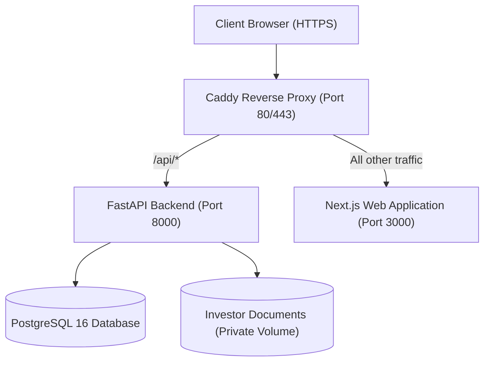

# EIDEN BOUNTY SDN. BHD. — Web Platform & Operations Hub

> [!IMPORTANT]
> **DEPLOYMENT STATUS: NOT DEPLOYED — NOT PRODUCTION-READY**  
> The EDEN BOUNTY web platform is undergoing pre-release staging preparation. No production server, managed database, domain DNS record, or live email service has been provisioned. Any production deployment must be authorized by executive leadership, conducted on client-controlled infrastructure, and deployed from an approved tagged release. Refer to [PRODUCTION_READINESS.md](PRODUCTION_READINESS.md) for the complete readiness audit and deployment prerequisites.

---

## 1. Project Overview

**EIDEN BOUNTY SDN. BHD.** is a Malaysia-based wholesale trading and business solutions company. This repository contains the complete full-stack web platform supporting commercial operations, prospective client intake, customer order management, and investor reporting:

1. **Public Commercial Catalogue:** Verified commercial presentations, technical scopes, and Request for Quotation (RFQ) intake for six approved business services.
2. **Customer Portal (`/account`):** Self-registration, email verification workflow, purchase order tracking, milestone event histories, and RFQ monitoring with strict tenant isolation.
3. **Investor Portal (`/investors/portal`):** Capital allocation tracking, recorded principal investment totals, status breakdowns, and a confidential document room with streaming PDF downloads from private storage. Figures represent recorded principal amounts only; the platform does not calculate or project financial returns, yields, profits, or valuations.
4. **Administrative Console (`/admin`):** Role-based access control (`SUPER_ADMIN`, `OPERATIONS_ADMIN`), commercial enquiry management, purchase order administration, user account management, and security audit logging.

---

## 2. Approved Commercial Services

Public trading operations are organised into six approved commercial services.

```
1. Mineral Water
2. Scrap Trading
3. Construction / Building Promotion
4. Petroleum Products
5. Furnace Oil
6. Drone Solutions
```

### Technical Service Reference Table

The following system reference codes are used internally for database primary keys, Alembic migration seeds, and API payloads.

> [!NOTE]
> **Technical Scope Clarification:** System codes (e.g. `EB-DIV-01`) are internal database identifiers used in API models and backend tracking. They are not public-facing website brand labels.

| Commercial Service (Public Website) | Internal System Code | Operational Scope |
|---|:---:|---|
| **Mineral Water** | `EB-DIV-01` | Bottled natural mineral water and bulk drinking water supply |
| **Scrap Trading** | `EB-DIV-02` | Ferrous and non-ferrous industrial scrap metal trading |
| **Construction / Building Promotion** | `EB-DIV-03` | Infrastructure contracting, building materials, and site promotion |
| **Petroleum Products** | `EB-DIV-07` | Wholesale refined petroleum fuels and commercial energy products |
| **Furnace Oil** | `EB-DIV-09` | Heavy industrial fuel oil and commercial heating solutions |
| **Drone Solutions** | `EB-DIV-10` | Agricultural, aerial mapping, and industrial drone equipment |

*(Note: Internal division codes `EB-DIV-05`, `EB-DIV-06`, and `EB-DIV-08` represent withdrawn historical categories deactivated in migration `0012`).*

---

## 3. Technology Stack

* **Frontend:** Next.js 16 (App Router), React 19, TypeScript (Strict), Tailwind CSS v4, Framer Motion, Three.js
* **Backend:** FastAPI (Python 3.12+), SQLAlchemy 2.0 (Asyncpg), Pydantic v2, Uvicorn
* **Database & Migrations:** PostgreSQL 16 with Alembic forward migrations (active head `0012`)
* **Security & Reverse Proxy:** Caddy 2.10 (Reverse Proxy, Automatic TLS via Let's Encrypt, CSP, HSTS, Secure Cookies)
* **Storage:** Private persistent Docker volume for confidential investor documents
* **Testing:** Pytest (Backend unit, integration, and RBAC security suites), Playwright (Browser acceptance suites)

---

## 4. System Architecture

The production architecture is deployed as an isolated multi-container stack orchestrated via Docker Compose:



---

## 5. Repository Structure

```text
.
├── assets/                     # Canonical design tokens (CSS custom properties, JSON, Tailwind mapping)
├── backend/                    # FastAPI backend application
│   ├── alembic/                # Alembic migration environment and active revision chain (0001–0012)
│   │   ├── deferred/           # Documented deferred migrations (outside active chain)
│   │   └── versions/           # Authoritative migration files
│   ├── app/                    # Application source code (api, cli, core, db, models, schemas, services)
│   ├── tests/                  # Pytest automated test suite
│   ├── .env.example            # Local development environment variable template
│   ├── Dockerfile              # Local development container definition
│   ├── Dockerfile.prod         # Hardened production multi-stage container definition
│   └── requirements.txt        # Backend Python dependency manifests (and requirements.lock)
├── deploy/                     # Deployment tooling and infrastructure configuration
│   ├── Caddyfile               # Production reverse proxy configuration with automatic TLS
│   └── backup-documents.sh     # Encrypted document backup script (streams into age)
├── design-system/              # Design system documentation and token manuals
├── docs/                       # Corporate guidelines and brand identity specifications
│   └── brand-guidelines.md     # Approved brand colors, typography, and identity rules
├── e2e/                        # Playwright end-to-end acceptance test suite
│   ├── tests/                  # Browser test specifications (site, portal, admin)
│   ├── seed_local.py           # Synthetic local test fixture seeder
│   └── test-helpers.ts         # Authentication and session test helpers
├── public/                     # Static frontend assets (service photography, fonts, icons)
├── scripts/                    # Test and local environment execution scripts
│   ├── start-local-acceptance-env.sh  # Local acceptance stack runner
│   └── test-e2e-local.sh       # Isolated disposable-database E2E test runner
├── src/                        # Next.js 16 App Router application
│   ├── app/                    # Route handlers, site pages, customer portal, investor portal, admin
│   ├── components/             # Reusable UI components (site, forms, portal, admin)
│   ├── config/                 # Site configuration and navigation metadata
│   ├── context/                # Client state contexts (Theme, PortalAuth, AdminAuth)
│   ├── data/                   # Division definitions and commercial operations data
│   ├── hooks/                  # Custom React hooks
│   ├── lib/                    # Client API wrappers and utility functions
│   └── types/                  # TypeScript interface definitions
├── .dockerignore               # Docker build context exclusion rules
├── .env.production.example     # Sanitized production/staging environment template
├── .gitignore                  # Git repository exclusion rules
├── DATABASE_SETUP.md           # Database setup, migrations, and restore guide
├── DEPLOYMENT_GUIDE.md         # Staging/production deployment procedures
├── Dockerfile                  # Standalone production frontend container definition
├── docker-compose.yml          # Local development stack (PostgreSQL + FastAPI)
├── docker-compose.prod.yml     # Production multi-container stack (Caddy, Web, API, Storage)
├── next.config.ts              # Next.js configuration, security headers, rewrites, and redirects
├── package.json                # Frontend dependencies, scripts, and devDependencies
├── playwright.config.ts        # Playwright test configuration
├── PRODUCTION_ENVIRONMENT_VARIABLES.md # Environment variable reference and validation guards
├── PRODUCTION_READINESS.md     # Readiness audit, verification findings, and deployment checklist
├── ROLLBACK_GUIDE.md           # Emergency application, database, and DNS rollback procedures
└── tsconfig.json               # TypeScript compiler configuration (strict mode)
```

---

## 6. Local Development Setup

### Prerequisites
* **Node.js:** Version 20.x or higher and `npm`
* **Docker:** Docker Engine and Docker Compose plugin (for local PostgreSQL and API services)
* **Python (optional for host development):** Version 3.12+ and `venv`

### Quickstart with Docker Compose (Recommended)

1. **Configure local environment variables:**
   ```bash
   cp backend/.env.example .env
   ```
   *The default configuration binds PostgreSQL to `127.0.0.1:5433` (avoiding local port 5432 conflicts) and FastAPI to `127.0.0.1:8000`.*

2. **Start the local database and backend containers:**
   ```bash
   docker compose up -d
   ```

3. **Run database migrations to the active head:**
   ```bash
   docker compose exec backend alembic upgrade head
   ```

4. **Seed initial commercial divisions:**
   ```bash
   docker compose exec backend python -m app.scripts.seed_divisions
   ```

5. **Install frontend dependencies and start Next.js:**
   ```bash
   npm install
   npm run dev
   ```
   *Access the web application at `http://localhost:3000`.*

> [!WARNING]
> **Database Safety Notice:** Never point `DATABASE_URL` at a staging or production database when running local commands or migrations. Local migrations should only be executed against the local Docker container (`eb_postgres_dev` on port 5433) or an isolated disposable test database.

---

## 7. Testing Instructions

All automated test suites must pass before staging deployments:

* **Backend Unit & Integration Tests:**
  ```bash
  cd backend
  pytest
  ```

* **Local Playwright E2E Browser Tests:**
  Runs acceptance tests in an isolated disposable PostgreSQL container created and torn down on loopback only:
  ```bash
  npm run test:e2e:local
  ```

* **TypeScript Type Checking:**
  ```bash
  npm run typecheck
  ```

* **Frontend Code Quality & Linting:**
  ```bash
  npm run lint
  ```

* **Production Frontend Build Check:**
  ```bash
  npm run build
  ```

---

## 8. Authoritative Handover Documentation

Review these five operational guides before scheduling staging verification or production deployment:

1. [**DEPLOYMENT_GUIDE.md**](DEPLOYMENT_GUIDE.md)  
   Staging and production deployment procedures, server prerequisites (Ubuntu 24.04 LTS), Caddy ingress setup, smoke tests, and operational management commands.
2. [**DATABASE_SETUP.md**](DATABASE_SETUP.md)  
   Managed PostgreSQL 16 setup, connection isolation, Alembic migration graph, point-in-time matching backup procedures, and non-destructive restore rehearsal instructions.
3. [**PRODUCTION_ENVIRONMENT_VARIABLES.md**](PRODUCTION_ENVIRONMENT_VARIABLES.md)  
   Complete reference for all staging and production variables, startup safety validation rules, and mandatory secret guards.
4. [**PRODUCTION_READINESS.md**](PRODUCTION_READINESS.md)  
   Full technical readiness audit, verification of implemented portal capabilities, identified infrastructure blockers, and the pre-flight checklist.
5. [**ROLLBACK_GUIDE.md**](ROLLBACK_GUIDE.md)  
   Step-by-step procedures for rapid container rollback, database point-in-time recovery, configuration reversion, and emergency cutover stop sequences.

*(For visual identity, styling tokens, and typography specifications, refer to [**docs/brand-guidelines.md**](docs/brand-guidelines.md)).*

---

## 9. Security & Secret Governance

* **Never Commit Credentials:** Real `.env` files, database passwords, SMTP secrets, JWT secret keys, and private certificates must **never** be committed to version control.
* **Environment Templates:** Use [`.env.production.example`](.env.production.example) for staging/production and [`backend/.env.example`](backend/.env.example) for local development.
* **Secret Generation:** Generate high-entropy cryptographic keys using `openssl rand -hex 32` or Python `secrets.token_urlsafe()`.
* **Startup Validation Guard:** In production mode (`APP_ENV=production`), the backend startup sequence validates that secret keys are set, placeholder passwords are rejected, and public URLs use HTTPS. The container will refuse to start if development defaults are detected.
* **Infrastructure Key Separation:** Backup archives are encrypted using `age` public-key encryption. The application server must only store public recipient keys (`AGE_RECIPIENTS_FILE`); private decryption keys must never reside on the staging or production server.

---

## 10. License & Proprietary Rights

Copyright © 2026 **EIDEN BOUNTY SDN. BHD.** All rights reserved.  
Confidential and proprietary commercial wholesale platform source code. Unauthorized reproduction, modification, or distribution is strictly prohibited.
